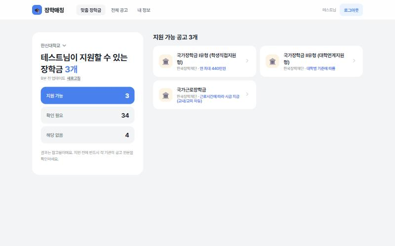
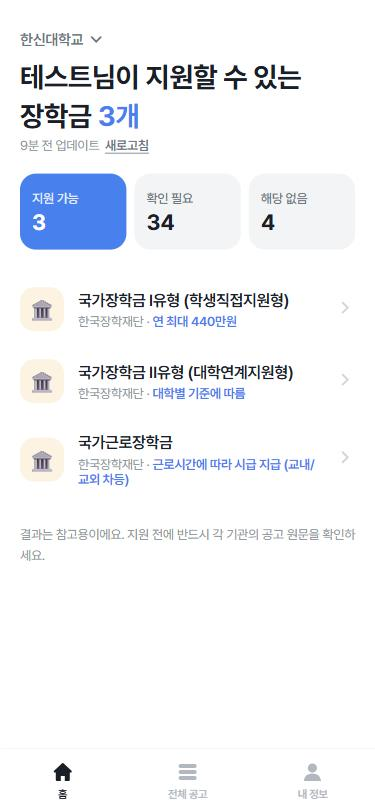
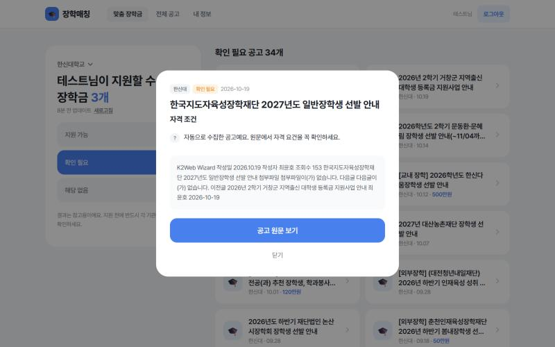
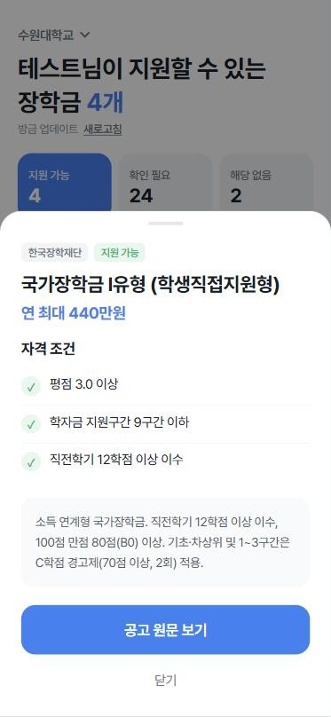

<div align="center">


# 장학매칭

**수원·화성·오산 대학생을 위한 맞춤 장학금 알림 서비스**

내 학교를 고르면 학교 장학 공지와 한국장학재단 장학금을 모아서<br />
내 학년·평점·소득구간으로 **지원 가능 / 확인 필요 / 해당 없음**을 알려드려요.

[](https://scholarship-match-bice.vercel.app)


-4169E1?logo=postgresql&logoColor=white)


</div>

---

## 📸 화면

| 웹 (PC) | 앱 (모바일) |
|---|---|
|  |  |
|  |  |

## ✨ 주요 기능

- **학교 선택 → 장학 공지 자동 수집**: 수원·화성·오산 11개 대학 장학 게시판을 크롤링 (6시간 캐시, 매일 새벽 자동 갱신)
- **한국장학재단 장학금 포함**: 국가장학금 Ⅰ·Ⅱ유형, 다자녀, 국가근로 등 주요 프로그램 + 재단 공지사항
- **맞춤 판정**: 학년·평점·이수학점·학자금 지원구간·다자녀/기초생활수급 등으로 지원 가능 여부와 예상 금액 표시
- **자격 조건 체크리스트**: 공고마다 충족 ✓ / 미충족 ✕ / 확인 필요 ? 를 한눈에
- **웹 + 앱 동시 지원**: 하나의 React 코드로 PC 웹 레이아웃과 모바일 앱 레이아웃을 자동 전환, 홈 화면에 앱으로 설치(PWA)
- **토스(Toss) 스타일 디자인**: 큰 타이포, 둥근 카드, 바텀시트, 하단 탭바

## 🏫 지원 대학

| 지역 | 대학 |
|---|---|
| 수원시 | 경기대학교(수원캠퍼스) · 성균관대학교(자연과학캠퍼스) · 아주대학교 · 수원여자대학교 · 동남보건대학교 |
| 화성시 | 수원대학교 · 협성대학교 · 장안대학교 · 수원과학대학교 |
| 오산시 | 한신대학교 · 오산대학교 |

대학 추가·수정은 [`backend/crawler/universities.py`](backend/crawler/universities.py)의 `UNIVERSITIES` 목록만 고치면 됩니다.

## 🖥️ 웹과 앱, 두 가지 버전

| | 웹 (화면 폭 900px 이상) | 앱 (900px 미만 / 홈 화면에 설치) |
|---|---|---|
| 내비게이션 | 상단 메뉴바 | 하단 탭바 |
| 홈 | 왼쪽 요약 패널 + 오른쪽 2열 카드 | 한 줄 목록 |
| 공고 상세 | 가운데 모달 | 아래에서 올라오는 바텀시트 |
| 로그인 | 왼쪽 소개 + 오른쪽 폼 | 전체 화면 폼 + 하단 고정 버튼 |

**앱으로 설치하기**
- 안드로이드(크롬): 메뉴 → **앱 설치** (또는 내 정보 화면의 설치 버튼)
- 아이폰(사파리): 공유 버튼 → **홈 화면에 추가**
- PC(크롬·엣지): 상단 **앱 설치** 버튼

## 🧱 기술 스택과 구조

```
React (Vite, PWA)  ──/api──▶  Flask (Python 서버리스)  ──▶  PostgreSQL (Neon)
                                   │
                                   └─ requests + BeautifulSoup 로 대학·한국장학재단 게시판 크롤링
```

```
장학금/
├─ frontend/                React 18 + Vite
│  ├─ public/               manifest.webmanifest, sw.js(서비스 워커), 앱 아이콘
│  └─ src/
│     ├─ pages/             Login, Register, SelectSchool, Profile, Home, Scholarships
│     ├─ components/        ui.jsx(상단 메뉴·탭바·바텀시트·토스트·앱 설치), Scholarship.jsx
│     ├─ auth.jsx           로그인 상태(Context)
│     └─ api.js             백엔드 호출
├─ backend/                 Flask + SQLAlchemy
│  ├─ app.py                API 서버
│  ├─ auth.py               회원가입·로그인·탈퇴 (비밀번호 해시 + JWT)
│  ├─ models.py             User, Profile, Scholarship, CrawlLog
│  ├─ matcher.py            회원 정보 ↔ 장학금 조건 비교
│  ├─ seed.py               한국장학재단 주요 장학 프로그램
│  └─ crawler/              universities.py(대학별 설정) · kosaf.py · base.py · run.py
├─ api/index.py             Vercel 서버리스 진입점
└─ vercel.json              배포 설정 (서울 리전, 매일 자동 크롤링)
```

## 🚀 로컬에서 실행하기

필요한 것: Python 3.9+, Node.js 18+

**1) 백엔드**
```bash
cd backend
python -m venv venv
venv\Scripts\activate          # macOS/Linux: source venv/bin/activate
pip install -r requirements.txt
python app.py                  # http://127.0.0.1:5000
```

**2) 프론트엔드** (새 터미널)
```bash
cd frontend
npm install
npm run dev                    # http://localhost:5173
```

> VS Code를 쓴다면 `실행 및 디버그(Ctrl+Shift+D)` → **▶ 전체 실행 (백엔드 + 프론트엔드)** → `F5` 한 번으로 둘 다 켜집니다.

로컬에서는 DB 설정 없이 `backend/scholarship.db`(SQLite)를 자동으로 사용합니다.

**크롤링만 따로 실행**
```bash
cd backend
python -m crawler.run          # 모든 대학 + 한국장학재단
python -m crawler.run hanshin  # 특정 대학만
```

## ☁️ 배포

Vercel 프로젝트 하나에 프론트엔드(정적 파일)와 백엔드(Python 서버리스 함수)를 함께 배포합니다.
`main` 브랜치에 push 하면 자동으로 배포되고, 직접 배포하려면:

```bash
npx vercel deploy --prod
```

필요한 환경변수: `DATABASE_URL`(Postgres), `SECRET_KEY`, `CRON_SECRET` — 자세한 내용은 **[DEPLOY.md](DEPLOY.md)**

## 🔌 API

| Method | URL | 설명 |
|---|---|---|
| POST | `/api/auth/register` · `/api/auth/login` | 회원가입 / 로그인 → `token` |
| DELETE | `/api/auth/me` | 회원 탈퇴 |
| GET | `/api/universities` | 지원 대학 목록 |
| GET · PUT | `/api/profile` | 내 정보 (학교 포함) |
| GET | `/api/matches` | 내 학교 + 한국장학재단 공고 매칭 결과 |
| POST | `/api/crawl` | 내 학교 크롤링 (6시간 내 수집했으면 건너뜀, `{"force": true}`로 강제) |
| GET | `/api/scholarships?university=&q=` | 전체 공고 검색 |
| GET | `/api/cron/crawl` | 매일 자동 크롤링 (Vercel Cron 전용) |
| GET | `/api/health` | 서버·DB 상태 |

## 📝 참고 및 한계

- 크롤링한 공지는 본문에서 `n구간 이하`, `평점 3.0 이상`, `12학점 이상` 같은 문구를 정규식으로 추출하기 때문에 대부분 **확인 필요**로 표시됩니다. 지원 전에는 반드시 공고 원문을 확인하세요.
- 각 대학 게시판은 최신 1페이지(10~20건)만 수집합니다.
- `seed.py`의 국가장학금 금액·구간 기준은 2025년 공고를 참고한 값이라 매년 갱신이 필요합니다.
- 크롤링은 요청 간 0.3초 간격, 상세 페이지는 1회 최대 8건으로 제한해 각 학교 사이트에 부담을 주지 않도록 했습니다.

---

<div align="center">
한신대학교 캡스톤디자인 프로젝트
</div>
